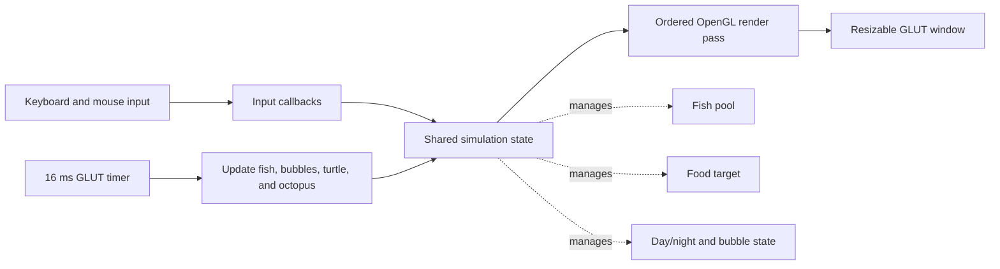

<div align="center">

# 🌊 Deep Sea Aquarium

### A real-time, interactive 2D graphics simulation built with C++ and OpenGL

<p>
  A code-first aquarium experience that combines procedural animation, autonomous fish behavior,
  event-driven input, and classic graphics techniques—built without a game engine.
</p>

<p>
  <a href="https://isocpp.org/"></a>
  <a href="https://www.opengl.org/"></a>
  <a href="https://freeglut.sourceforge.net/"></a>
</p>

</div>

> **Portfolio snapshot** — Deep Sea Aquarium is a desktop graphics project that turns a hand-crafted underwater scene into a responsive simulation. It demonstrates real-time rendering, stateful animation, simple steering behavior, coordinate transforms, and user interaction in one focused C++ application.

---

## The experience

Launch the application and explore a living aquarium rather than a static illustration:

- A mixed school of **five visually distinct fish profiles** swims with velocity, damping, boundary response, and subtle current noise.
- Drop food with the keyboard or mouse to pull nearby fish toward it.
- Switch between bright **day** and atmospheric **night** modes.
- Watch animated waves, bubbles, an octopus, a turtle, coral, seagrass, stones, a seashell, and a starfish bring depth to the scene.
- Increase the active school from **1 to 100 fish** to explore the simulation at a larger scale.

All visible scene geometry is drawn in code; the project does not rely on a game engine, sprite sheet, or external art pipeline.

---

## Portfolio highlights

| Area | Evidence in the project |
|---|---|
| **Real-time graphics** | Layered water, alpha blending, anti-aliased outlines, procedural circles, and ordered scene composition are rendered every frame. |
| **Interactive simulation** | GLUT keyboard and mouse callbacks mutate application state; a 16 ms timer drives simulation updates and redraws. |
| **Autonomous agents** | Each fish tracks position, velocity, scale, visual profile, phase, and direction; food attraction is balanced with random current, damping, speed limits, and boundary handling. |
| **Graphics fundamentals** | The implementation uses `GL_BLEND`, `GL_STENCIL_TEST`, GLU tessellation, matrix-stack transforms, orthographic projection, and sine-based motion. |
| **Visual craft** | Fish profiles, seabed layers, coral, leaves, turtle, octopus, and decorative details are composed from hand-authored geometry. |
| **Responsive desktop UI** | The viewport is resized through a GLUT reshape callback while the scene keeps its intended 1301 × 764 design space. |

### Runtime at a glance

| Metric | Current implementation |
|---|---:|
| Default school size | 15 fish |
| Fish capacity | 100 fish |
| Bubble pool capacity | 60 bubbles |
| Fish visual profiles | 5 — Koi, Blue Tang, Angelfish, Clownfish, and Cobalt Blue |
| Animation cadence | 16 ms timer interval (about 62.5 update opportunities/second) |
| Reference canvas | 1301 × 764, resizable |

---

## Interaction guide

| Input | Result |
|---|---|
| `D` | Enable day mode with sun rays |
| `N` | Enable night mode with stars and a crescent moon |
| `B` | Release / replenish a burst of bubbles |
| `F` | Drop food at a random valid location |
| Left mouse click | Place food in the aquarium |
| `+` or `=` | Add an active fish, up to 100 |
| `-` or `_` | Remove an active fish, down to 1 |
| `R` | Re-randomize fish positions and motion |
| `Space` | Toggle the animation pause state |
| `Esc` | Exit the application |

---

## How the simulation is organized



The application follows a compact callback-driven loop:

1. **Input callbacks** update scene state: day/night mode, food position, pause state, bubbles, or fish count.
2. The **timer callback** advances animation time and updates moving entities.
3. The **display callback** draws the scene back-to-front, then swaps buffers for a smooth double-buffered result.
4. The **reshape callback** updates the viewport and orthographic projection when the window size changes.

### Render order matters

The scene is intentionally layered so visual depth stays readable:

```text
water and wave bands
  → sunlight / sky treatment
  → sand, stones, shell, starfish, coral, and seagrass
  → octopus, turtle, fish, bubbles, and food
  → night tint, stars, and moon when night mode is enabled
```

---

## Technical deep dive

| System | Approach | Skills demonstrated |
|---|---|---|
| **Water surface** | Three independently parameterized, sine-based wave layers are blended over a water gradient. | Procedural animation, compositing, trigonometry |
| **Fish behavior** | Fish receive a gradual pull toward active food, small randomized current forces, velocity damping, speed caps, and edge correction. | Lightweight agent simulation, vector math, state management |
| **Moon masking** | A circle and offset shadow circle use the stencil test to create a crescent. | GPU state management, stencil-buffer concepts |
| **Organic geometry** | Concave shapes use the GLU tessellator; other visual elements are built from polygons, strips, points, and outlines. | Geometry construction, tessellation, primitive selection |
| **Character motion** | The octopus uses `glPushMatrix` / `glPopMatrix`, translation, and rotation around a chosen pivot; the turtle follows an independent sinusoidal path. | Hierarchical transforms, time-based motion |
| **Sun and bubbles** | A midpoint-circle routine draws the sun; a reusable bubble pool rises, drifts, and fades. | Raster graphics fundamentals, particle-pool lifecycle |

### Code tour

The canonical executable is intentionally easy to review: [`src/main.cpp`](src/main.cpp) contains the current simulation and rendering pipeline.

- [`water()`](src/main.cpp#L357) — gradient, layered waves, blending, and line smoothing
- [`drawFish()` / `initFish()`](src/main.cpp#L819) — fish rendering and pool initialization
- [`updateFish()`](src/main.cpp#L935) — food attraction, movement, speed limiting, and collision bounds
- [`updateTurtle()`](src/main.cpp#L1575) and [`updateOctopus()`](src/main.cpp#L2795) — independent animated actors
- [`display()`](src/main.cpp#L8526) — frame composition and render order
- [`timer()`](src/main.cpp#L8585) — simulation clock and redraw scheduling
- [`keyboard()` / `mouse()`](src/main.cpp#L8605) — interaction layer

---

## Build and run

### Prerequisites

You need:

- A compiler with C++17 support (`g++`, `clang++`, or MinGW)
- OpenGL, GLU, and GLUT/FreeGLUT development libraries
- A graphics driver that supports the OpenGL compatibility profile used by immediate-mode rendering

Clone the repository, then run the platform-specific command from the project root:

```bash
git clone https://github.com/mdzishanSarkar/Deep-Sea-Aquarium.git
cd Deep-Sea-Aquarium
```

### Linux — Ubuntu / Debian

```bash
sudo apt update
sudo apt install build-essential freeglut3-dev libglu1-mesa-dev

g++ -std=c++17 src/main.cpp -o aquarium -lglut -lGLU -lGL -lm
./aquarium
```

### macOS — Homebrew

```bash
brew install freeglut

clang++ -std=c++17 src/main.cpp -o aquarium \
  -I"$(brew --prefix freeglut)/include" \
  -L"$(brew --prefix freeglut)/lib" \
  -lglut -framework OpenGL

./aquarium
```

> macOS may emit an OpenGL deprecation warning. That warning reflects the operating system's OpenGL policy, not a failed build.

### Windows — MinGW

The repository includes `include/`, `lib/libfreeglut.a`, and `freeglut.dll` for the bundled MinGW-style setup.

```bat
g++ -std=c++17 -Iinclude src\main.cpp -o aquarium.exe ^
  -Llib -lfreeglut -lopengl32 -lglu32 -lgdi32 -lwinmm

aquarium.exe
```

Keep `freeglut.dll` beside `aquarium.exe` when you run the program. A prebuilt Windows executable (`myProgram.exe`) is also included for convenience; rebuilding locally is recommended for a reproducible, architecture-matched binary.

### Common build issues

| Symptom | Likely fix |
|---|---|
| `GL/glut.h: No such file or directory` | Install the FreeGLUT/GLUT development package, then retry the platform command above. |
| Linker cannot find `-lGLU` or `-lglut` | Confirm the GLU and FreeGLUT development libraries are installed, not only the runtime packages. |
| Windows reports a missing `freeglut.dll` | Place the bundled DLL in the same directory as the generated `.exe`. |

---

## Repository layout

```text
Deep-Sea-Aquarium/
├── src/
│   ├── main.cpp              # Primary executable: rendering, simulation, and input callbacks
│   ├── Project/              # Component experiments and earlier project source material
│   ├── Lab/                  # Supporting OpenGL lab exercises
│   └── glad.c                # Included OpenGL loader source
├── include/                  # Bundled FreeGLUT, GLFW, GLAD, and Khronos headers
├── lib/                      # Bundled static libraries for the Windows-oriented setup
├── freeglut.dll              # Windows FreeGLUT runtime
├── myProgram.exe             # Prebuilt Windows executable
└── README.md
```

> For the current application, compile `src/main.cpp`. The files under `src/Project/` and `src/Lab/` are preserved as supporting work rather than additional compilation units for the aquarium executable.

---

## Engineering context

This project deliberately uses **classic fixed-function OpenGL** rather than a modern shader pipeline. That choice keeps the graphics fundamentals explicit and inspectable: primitives, colors, blending, matrix transforms, tessellation, stencil state, and render order are all visible in the source.

If this prototype were evolved into a production-scale graphics application, natural next steps would be to separate simulation from rendering, use delta-time updates, move geometry into reusable model data, add automated build targets, and migrate the renderer to modern OpenGL with shaders and vertex buffers. The current implementation is valuable precisely because it makes the underlying graphics and interaction decisions easy to study.

---

<div align="center">

**Built as a hands-on C++ graphics portfolio project — explore the source, run the aquarium, and follow the animation loop from input to pixels.**

</div>
